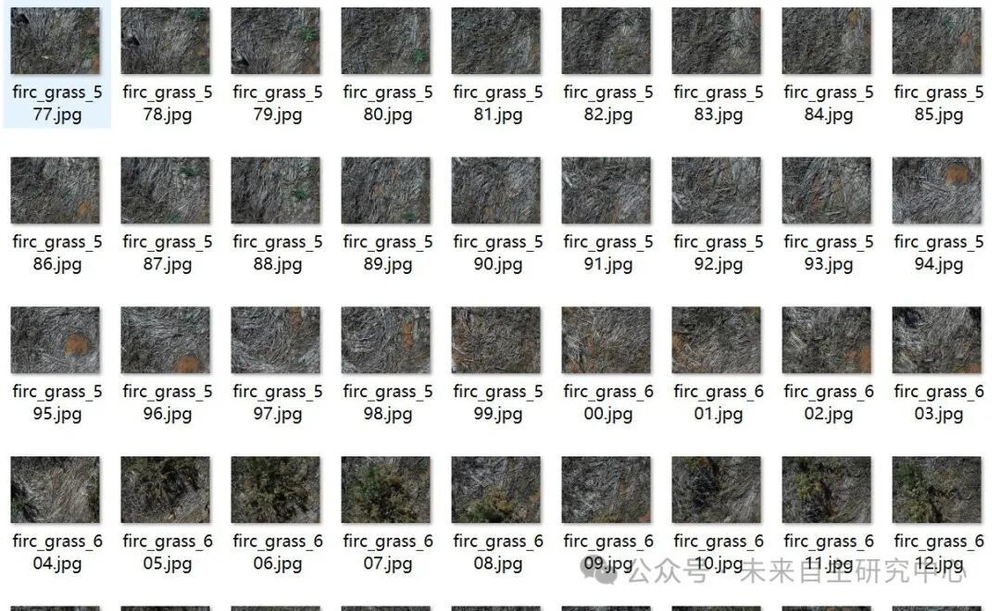
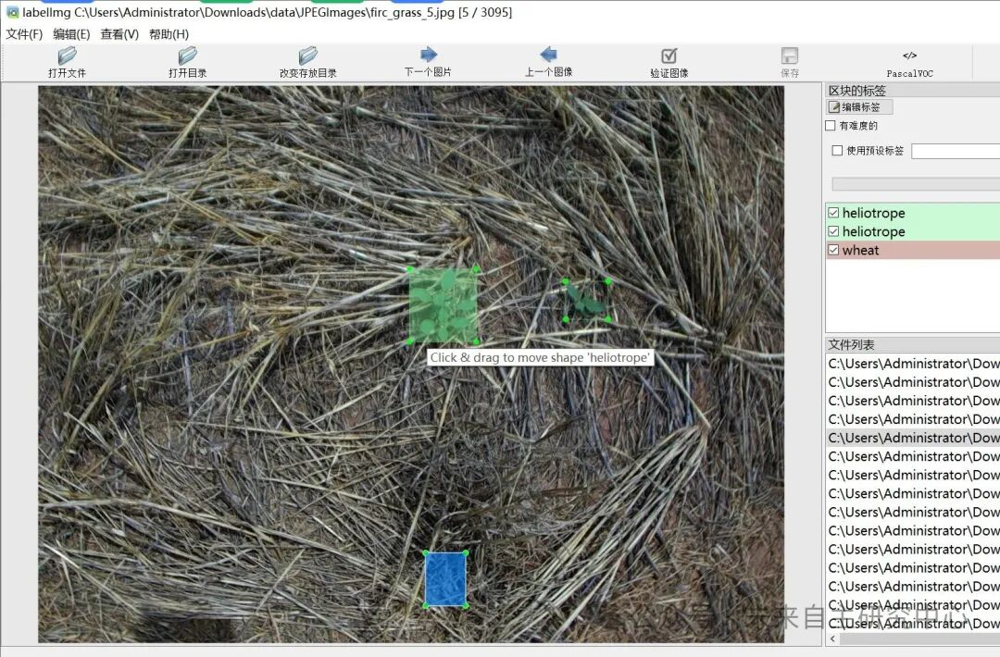

# 24 Types of Weeds Common in Field Irrigation with Intelligent Agriculture - VOC+YOLO format, 3095 images, 24 categories

Dataset format: Pascal VOC format + YOLO format (txt file without split path, only containing jpg images and corresponding VOC format xml files and yolo format txt files)

Number of images (number of jpg files): 3095

Number of annotations (number of xml files): 3095

Number of annotations (number of txt files): 3095

Label count: 24

["Barley", "Bindweed", "Burr Grass", "Caustic", "Fleabane", "Foxtail", "Green", "Heliotrope", "Inactive Mouse Hole", "Indian-Hedge Mustard", "Medic", "Melon", "Moth", "Onion", "Pea", "Rolypoly", "Skeleton Weed", "Sowthistle", "Stemless Thistle", "Stink Grass", "Thistle -Generic-", "Turnip", "Wheat", "Wild Radish"] => [Barley, Rolypoly, Caustic, Fleabane, Foxtail, Green, Heliotrope, Inactive Mouse Hole, Indian-Hedge Mustard, Medic, Melon, Moth, Onion, Pea, Rolypoly, Skeletal Weed, Sowthistle, Stemless Thistle, Stink Grass, Thistle -Generic-, Turnip, Wheat, Wild Radish]

Number of boxes labeled in each category:

Barley frame count = 10

Bindweed frame count = 87

Burr grass frame count = 88

Caustic frame count = 240

fleabane frame count = 1766

Foxtail frame count = 252

Green frame count = 605

Heliotrope frame count = 1876

Inactive mouse hole frame count = 31

Indian-hedge-mustard frame = 26

Medic Frame Count = 8

melon frame count = 1

moth frame count = 2

Onion frame count = 617

Number of peas = 13

Rolypoly Frame Count = 32

Skeleton weed frame count = 71

sowthistle frame count = 1212

Stemless thistle frame count = 3

stink grass frame count = 23

Thistle -generic- Frames = 13

Turnip frame count = 7

Wheat frame count = 19

Wild radish frame count = 4

Total frame count: 7006

Using labelImg:

Annotation rules: Draw a rectangle around the category.

Important Notice: No

Special : This dataset does not guarantee the accuracy or precision of the trained models or weight files. The dataset is provided with accurate and reasonable annotations only.

Image Preview:

Annotation example:

## Payment

Here is a pay link on Stripe ( https://buy.stripe.com/3cs8yP7sY87d0vu9AB ). Please contact me lonlonago@foxmail.com after funding $89, and I will send you a complete data files , thank you!

